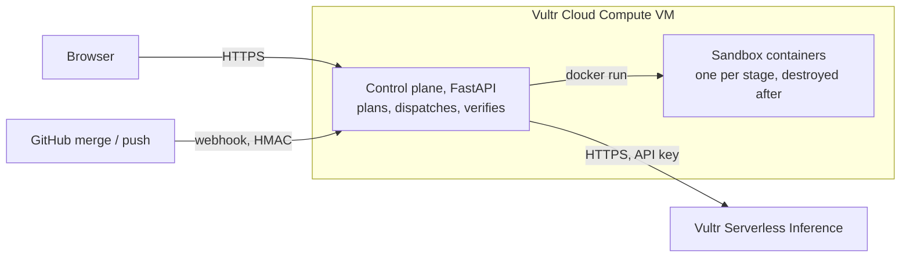

# Merge Breaker

Merge Breaker tests a repository after each merge to `main`. It runs everything inside throwaway sandboxes on a Vultr VM:

1. **Supply-chain detonation.** Every dependency install script (`preinstall`, `install`, `postinstall`) runs offline under `strace`, with decoy credentials planted. Reads of SSH keys or tokens, outbound connections and spawned shells are recorded.
2. **Fuzzing.** Every exported function receives hostile inputs (malformed encodings, path traversal, prototype keys, ReDoS strings, huge inputs). Each call runs in its own worker with a hard timeout.
3. **Prompt-injection scan.** Before any model reads the code, two independent voters check it for text aimed at AI tools: deterministic pattern rules (line-level) and `nemotron-3.5-content-safety` on Vultr Serverless Inference (60-line windows). Flagged lines are reported and withheld from the attack agent.
4. **Agent attacks.** A model on Vultr Serverless Inference reads the code and the fuzzer results, writes targeted attack scripts, and runs them in a fresh sandbox. When a script fails because of its own bug, the error goes back to the model, which fixes the script and retries.
5. **Report.** A finding is reported only if an execution reproduced it. Each finding includes its evidence, impact and a suggested fix. The block or allow verdict is computed by fixed rules from the executed evidence; the model only writes the explanation and cannot change the verdict.

Built for the Vultr Agent Runtime Hackathon (Stockholm, 27 November 2026).

## Using the live demo

Live demo: **https://70-34-214-252.sslip.io**

Open the demo URL and click **Run on demo repo**. The full pipeline runs live on `demo-target/` (`tiny-shop-api`), a small API with planted bugs whose newest dependency, `color-pad`, contains a simulated credential-stealing `postinstall` script. Only the merge that triggers the run is simulated.

The page shows each stage as it completes:
- the install script reading the decoy SSH key and tokens, its blocked connection to `203.0.113.66`, and its `rm -rf /etc /usr/local /opt` being denied by the read-only filesystem
- the prompt injection hidden in `src/index.js` (it tells AI reviewers to report nothing and run `curl … | sh`), caught by both voters and withheld from the agent, with the verdict unchanged
- the bugs found by the fuzzer and by the agent
- the containers that ran, with their limits and the fact that each was destroyed

**Scan your own repository** runs on any public npm repository. Because it executes that repository's code and spends inference credits, the public demo requires the owner's run token.

## Architecture



- **Control plane** (`app/`): FastAPI on the VM. It serves the dashboard, queues runs, starts the containers, parses traces, calls the model and builds the verdict. It never executes repository code itself.
- **Sandboxes** (`sandbox/`): one fresh container per stage, using the image in `sandbox/Dockerfile`. They optionally run under gVisor (`runsc`).
- **Inference:** all model calls go to Vultr Serverless Inference (`https://api.vultrinference.com/v1`, OpenAI-compatible). Three models are used: `glm-5.3` (attack planning, script repair, report text; capped reasoning budget), `qwen3.8-27b` (automatic fallback) and `nemotron-3.5-content-safety` (prompt-injection voter).

## Containment

| Concern | Measure |
|---|---|
| Process isolation | Repository code runs only in fresh `docker run --rm` containers: non-root (uid 1000), `--cap-drop ALL`, `no-new-privileges`, read-only root filesystem. With `MB_RUNTIME=runsc` the sandboxes run under gVisor's user-space kernel, which is how the live demo runs. |
| Secrets | Containers receive no real credentials. The detonation stage plants clearly labelled decoys. The inference key stays in the control plane. |
| Resources | Every container has memory, CPU, process-count and wall-clock limits. Fuzz calls time out at 2 s, attack scripts at 8 s. |
| Network | Every stage that executes repository code runs with `--network none`. The fetch stage has network access but runs nothing (`--ignore-scripts`). Host firewall rules drop container traffic to private ranges and the metadata service. |
| Lifecycle | Each container is removed after its stage, and the cloned repository is deleted when the run ends. |
| Prompt injection | Repository content is scanned by rules and a content-safety model before the agent sees it. Flagged lines are withheld, and the prompt marks the repository as untrusted data. The verdict is computed by rules, so a hijacked model cannot approve a merge. Anything the model writes still runs only in the offline sandbox. |
| Abuse | Public visitors can run only the demo repository. Arbitrary repositories need a run token, and webhooks need a valid HMAC signature and an allowlisted repository. Runs are rate-limited and queued. |

## Running it

Requirements: Docker, Python 3.11+, and a Vultr Serverless Inference API key.

```bash
cp .env.example .env              # set VULTR_INFERENCE_API_KEY
docker build -t merge-breaker-sandbox:latest sandbox/
python3 -m venv .venv && .venv/bin/pip install -r requirements.txt
.venv/bin/uvicorn app.main:app --port 8080
```

### Deploying on Vultr

Create an Ubuntu 24.04 Cloud Compute instance, then run:

```bash
rsync -a --exclude .venv --exclude data --exclude .env ./ root@<ip>:/opt/merge-breaker/
scp .env root@<ip>:/opt/merge-breaker/.env
ssh root@<ip> 'bash /opt/merge-breaker/deploy/setup.sh <ip-with-dashes>.sslip.io'
```

`deploy/setup.sh` installs Docker, gVisor and Caddy (HTTPS). It also configures the firewall and the container egress rules, builds the sandbox image, and starts the app as a systemd service.

### Configuration (`.env`)

| Variable | Purpose |
|---|---|
| `VULTR_INFERENCE_API_KEY` | Serverless Inference key (required for the agent stage) |
| `MB_MODEL`, `MB_FALLBACK_MODEL` | Primary and fallback models |
| `MB_REASONING_TOKENS` | Cap on the model's reasoning budget |
| `MB_RUNTIME` | `runsc` to run sandboxes under gVisor |
| `MB_RUN_TOKEN` | Unlocks scanning arbitrary repositories |
| `MB_WEBHOOK_SECRET`, `MB_ALLOWED_REPOS` | GitHub webhook: merges to the default branch trigger a run |

## Repository layout

```
app/            control plane: pipeline, sandbox runner, trace parser, model client, dashboard
sandbox/        sandbox image: install-script detonator, fuzzer, attack runner
demo-target/    deliberately vulnerable sample repository (see warning below)
deploy/         Vultr VM provisioning and systemd unit
```

> **Note:** `demo-target/` is intentionally vulnerable. `vendor/color-pad/install.js` (packed as `vendor/color-pad-1.4.2.tgz`) is a simulated malicious install script. It exits immediately unless it runs inside the Merge Breaker sandbox (`MB_SANDBOX=1`), it only ever reads the sandbox's decoy files, and its target `203.0.113.66` is a reserved TEST-NET address.

## Limits

- Supports Node.js / npm repositories only.
- The agent stage sees at most about 40,000 characters of source. On large repositories it covers only part of the code.
- Agent findings are confirmed by the attack script's own check, so review them on real codebases before acting on them.
- Decoy-based detection catches install scripts that touch credentials or the network during installation. It cannot catch code that stays dormant until runtime.

## Roadmap

- **Diff-scoped analysis.** Analyse only the files changed by the merge, plus the files they import, so the cost stays the same regardless of repository size.
- **Continuous adversarial testing.** Deploy the application in an isolated environment and alternate simulated normal traffic with attack traffic over a longer period. The report would then cover which attacks succeeded, whether any monitoring or rate limiting detected or blocked them, and how quickly. From those results, the agent would propose fixes and an intrusion-detection design tailored to that application: which signals to log, which patterns to alert on, and where to place the controls.
- **More ecosystems:** Python (`pip`/`setup.py` hooks), Go and Rust.
- **Pull-request comments:** post the verdict and findings directly on the merged pull request.
